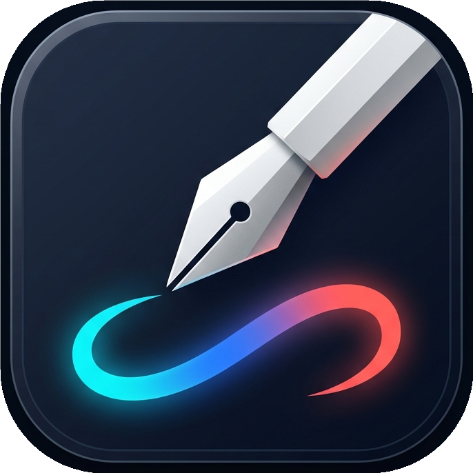

<p align="center">
  
</p>

<h1 align="center">TickPen</h1>

<p align="center">
  <strong>Herramienta open-source, ligera y nativa para anotar en tiempo real sobre cualquier ventana en Windows.</strong><br/>
  Pensada para <strong>traders, analistas financieros, educadores y presentaciones en vivo</strong>.
</p>

<p align="center">
  
  
  
  
</p>

---

## Características Principales

- **Modo Click-Through nativo (Win32):** interactúa con TradingView, MetaTrader, Excel, PowerPoint o cualquier ventana mientras tus anotaciones siguen visibles en pantalla.
- **Lápiz y Resaltador fluidos:** motor `InkCanvas` con suavizado de curvas (`FitToCurve`) y resaltador semitransparente.
- **Formas geométricas con vista previa en vivo:** Línea recta, Flecha con punta calculada, Rectángulo y Elipse *(mantén `Shift` para ángulos de 45°, cuadrados o círculos perfectos)*.
- **Herramienta de Texto:** haz clic en cualquier punto para escribir directamente sobre tus gráficos o diapositivas (`Enter` para fijar, `Esc` para cancelar).
- **Borrador dual:** borrado por trazo completo o por punto (compatible también con formas y texto).
- **Historial Undo / Redo unificado:** `Ctrl+Z` y `Ctrl+Y` sobre trazos, formas, texto e incluso sobre *Limpiar Pantalla*.
- **Ocultar / Mostrar tinta:** esconde tus anotaciones temporalmente sin perder tu análisis.
- **Captura de pantalla con anotaciones:** captura una región seleccionada o la pantalla completa directamente al portapapeles o como archivo PNG.
- **Barra flotante compacta y colapsable:** interfaz oscura arrastrable que nunca bloquea tu trabajo.

---

## Atajos de Teclado

| Atajo | Acción |
| :--- | :--- |
| `Ctrl + Shift + D` | Alternar entre **Modo Cursor** (*Click-Through*) y **Modo Dibujo** (global) |
| `Ctrl + Shift + H` | Ocultar / Mostrar la barra de herramientas (global) |
| `Ctrl + Shift + C` | Limpiar toda la pantalla (global) |
| `Ctrl + Z` / `Ctrl + Y` | Deshacer / Rehacer |
| `Shift` (al dibujar formas) | Restringir a cuadrados, círculos o líneas a 45° |

---

## Privacidad y Seguridad

TickPen es **100% local y offline**:
- **Sin conexión a internet:** no realiza peticiones HTTP, no usa APIs externas ni servicios de IA.
- **Sin telemetría ni rastreo:** no recopila datos de uso, capturas ni métricas.
- **Código auditable:** únicamente interactúa con `user32.dll` (modo *Click-Through* y atajos globales) y `gdi32.dll` (liberación segura de handles al copiar capturas al portapapeles).

Consulta [SECURITY.md](SECURITY.md) para más detalles.

---

## Compilación desde el Código Fuente

### Requisitos
- Windows 10 / 11 (x64)
- [.NET 8 SDK](https://dotnet.microsoft.com/download/dotnet/8.0) (o superior)

### Ejecutar en modo desarrollo
```powershell
dotnet run
```

### Generar ejecutable único autocontenido (`TickPen.exe`)
```powershell
dotnet publish -c Release -r win-x64 --self-contained true `
  -p:PublishSingleFile=true `
  -p:IncludeNativeLibrariesForSelfExtract=true `
  -p:EnableCompressionInSingleFile=true `
  -o .\publish\win-x64
```

El ejecutable final quedará en `.\publish\win-x64\TickPen.exe` (no requiere que el usuario tenga instalado .NET).

### Generar instalador para Windows (Opcional)
Con [Inno Setup 6](https://jrsoftware.org/isinfo.php) instalado:
```powershell
& "C:\Program Files (x86)\Inno Setup 6\ISCC.exe" .\Installer\TickPen.iss
```

---

## Licencia

Distribuido bajo licencia **MIT**. Consulta el archivo [LICENSE](LICENSE) para más información.
